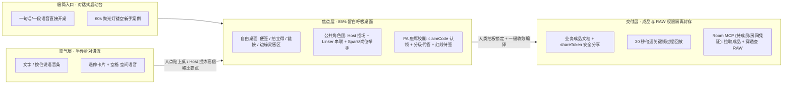
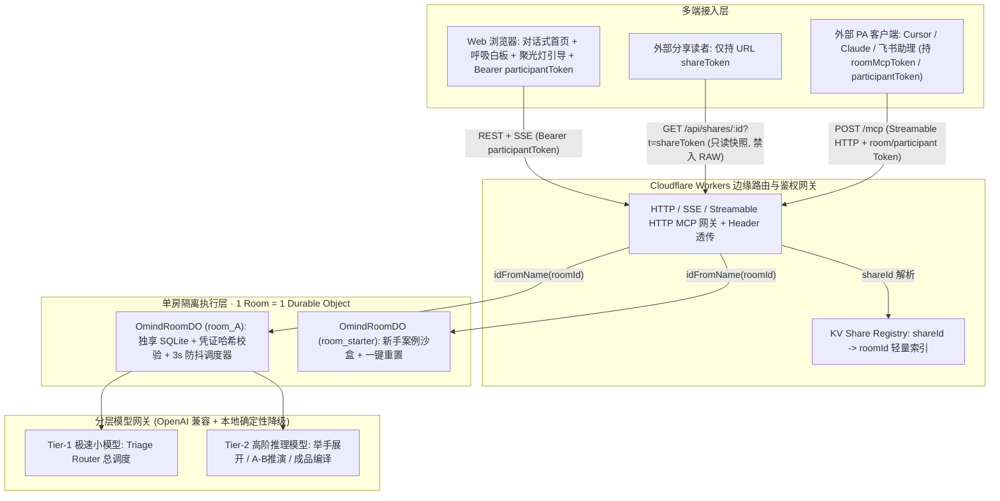

# Omind 新版架构与产品规范文档

> **版本**：v5.4（鉴权隔离 + V4 手感自由桌面 + 同心星轨 Obsidian 星图组织 + 8 步全功能聚光灯引导定版）
> **日期**：2026-11-26
> **定位**：让人带着各自的外部 AI（PA），与多角色思维搭档在同一张轻量白板上共创、拍板并直连执行的**半异步圆桌会议室**
>
> **修订记录（v5.0 $\rightarrow$ v5.1 $\rightarrow$ v5.2 $\rightarrow$ v5.3 $\rightarrow$ v5.4）**
>
> | 版本 | 日期 | 修订内容 |
> | :--- | :--- | :--- |
> | **v5.4** | 2026-11-26 | **「🕸 星图组织」升级为方案 2 + 3 组合（同心引力星轨 × Obsidian 发光星点星云）**：一键将杂乱自由便签经 60fps 物理引擎收拢至「中心引力核 · 内环强关联轨 · 外环灵感星云」（支持 `🪐 同心星轨 | 🔮 自由星云` 切换），自动织入隐式弱语义虚丝消除孤岛，3 遍 AABB 碰撞分离确保 0 重叠；支持纯净一阶邻域聚光、悬停/钉住原卡详情预览与一键跳回自由桌面定位编辑。 |
> | **v5.3** | 2026-11-26 | ① **自由桌面回归 V4 无界手作手感**：去掉右侧占屏虚线框，支持双击空白原地建卡打字、双击便签/连线原地编辑、5 色和纸胶带换色、左上 Host 实时梳理灵动岛（悬停高亮源卡）与记忆原位的星图组织； ② **60fps 弹簧物理弹性连线 + 左端无圆圈箭头折叠**：连线支持拖拽惯性回弹、扫过拨弦与橡皮筋磁吸预览；用户列表与 Agent 列表左端固定明显无圆圈箭头一键收放； ③ **双路召唤 Agent + 8 步全功能聚光灯引导**：支持拖拽顶栏角色/PA 上卡或点卡片 `🤖` 直接评估，聚光灯升级为支持跳步与跨三视图实时切换的 8 步完整闭环。 |
> | **v5.2** | 2026-11-26 | ① 视觉回归纯净 **Option A（Warm Editorial Craft）**，启用 `1A 流光穿环圆桌星轨` 品牌标志； ② 升级为 **对话式极简首页（Prompt-First Launchpad）**，精简去 AI 腔文案（`一张白板，把想法聊成方案。`），新增首访 4 大核心功能微缩卡与底部 30 家模拟企业 + 高管口碑双轨跑马灯； ③ 新增 **5 步半透明聚光灯镂空遮罩引导（Spotlight Mask Tour）** 配合自由桌面预置案例； ④ 升级为 **可爱风 / Emoji 头像徽章 + 30+ 组多元模拟用户名池**。 |
> | **v5.1** | 2026-11-26 | 补齐身份鉴权与权限隔离（YM UPDATE）。体验铁律更新为所有入口（人与 Agent）均需轻量凭证；进房签发 `participantToken`；分享链接携带 `shareToken` 且与 RAW 严格隔离；PA 会前投递增加 `claimCode` 认领防冒领流程。 |
> | **v5.0** | 2026-11-25 | 新范式 `1 Room = 1 SQLite DO` 与双层 Agent 架构基线。 |

---

## 1. 产品定位与核心隐喻

### 1.1 物理会议室 3 层模型

Omind 不模仿“沉底刷屏的群聊”，也不做“上手沉重的巨型无限白板”，而是完整映射一场**高质量物理会议室**的自然分工：

### 1.2 竞品格局与 Omind 唯一生态位

| 产品 | 核心强项 | 局限与警示 | Omind 差异化定位 |
| :--- | :--- | :--- | :--- |
| **Magic Patterns** | 对话式首屏（Prompt Launchpad）+ MCP 直连编码工具 | 聚焦 UI/前端原型生成；多分支生成烧 Token 严重 | 吸收其**零门槛对话式开局**与 MCP Server 闭环，聚焦**上游团队共创拍板**，用「举手懒加载」省 80% 算力 |
| **Miro Sidekicks** | 画布多光标 AI 专家 + 便签转 Docs | 企业级工具像飞机仪表盘；AI 锁在自家封闭生态 | **10 秒发链接进房**的温润桌面；支持**思维动作 + 业务岗位**双维拼装与开放 PA 连接 |
| **Glue** | 目标导向话题流 + MCP 写工单 | 偏线性群聊，缺乏空间碰撞与共识防冲突机制 | 兼具「空气对讲流」与「白板空间感」，内置**人类锁定 + 下游过期传导** |
| **Granola** | 静默不打扰、以人类短笔记为骨架生成高质纪要 | 单向会议记录工具，缺乏多人白板共创与多角色推演 | 吸收其**温润纸感美学**与**人类骨架优先**编译哲学，叠加受权限保护的 **RAW 上下文穿透检索** |
| **Cove / Kosmik** | 早期空间 AI 卡片画布（均已关停或退场） | **反面教材**：只有泛用发散画布，缺少确定性交付闭环 | 死守**「成品文档 + 可执行 MCP 决策包」**终局交付，绝不退化为灵感墓地 |

---

## 2. 产品体验规范（8 条不可动摇的体验铁律）

1. **对话式开局 + 轻量凭证，零阻力且有边界**：
   - 首屏采用无压迫感的**单输入框对话式启动台**（`一张白板，把想法聊成方案。`），配可爱风 Emoji 头像与 30+ 模拟昵称一键骰子入座，同时展示 4 大核心能力微缩卡与合作团队真实口碑；
   - 免账号密码注册，但**所有入口（人与 Agent）均签发轻量加密凭证**：进房时服务端签发 7 天有效 `participantToken`，后续个人权限操作均需携带 Bearer Token；对外定稿链接携带 `shareToken`，访问时强校验且仅暴露成品与回放，非裸奔匿名。
2. **聚光灯聚焦上手，拒绝说明书式迷茫**：首次来访提供预置好真实故事线的**自由桌面新手案例沙盒**，叠加 **5 步半透明遮罩聚光灯引导（Spotlight Mask Tour）**，哪里需要点按一目了然，60 秒跑通完整闭环。
3. **对讲机式半异步，不碰重型连麦**：只做文字 + 按住说语音条（以及悬停卡片按住 `Space` 的**空间锚定语音**），天然绑定发言人、零声纹分离误差，同时兼容实时碰撞与错峰接力。
4. **单人可起盘，多人自动降噪**：
   - `活跃真人 ≤ 1`：单人智囊模式，跳脱者/岗位角色自动把灵感卡落入右侧**边缘灵感区**；
   - `活跃真人 ≥ 2`：多人会议模式，角色自动退居辅助，严禁公屏刷屏。
5. **白板静默作业 + 举手点将**：`Host` 与 `Linker` 通过 0.8 秒轻盈微光标在白板静默拉线整理；`Spark`、`Critic` 与业务岗位在多人局仅亮出 `≤ 20 字` 悬念气泡举手，真人点击才展开，30 秒未点自动折叠。
6. **PA 纯连接器，一次性 `claimCode` 认领 + 分级授权控麦**：参会人会前用 MCP（携带房间凭证）把脱敏立场包投递进房，返回一次性 `claimCode`，由本人进房后用 `participantToken` 认领绑定，防止同名冒领。自选「仅提供上下文」或「分级授权代发言」——后台与 Host 通气协同，绝不公屏抢麦；凡涉及死线/预算/核心目标拍板红线，强制生成**待本人签字卡**。
7. **人类拥有绝对终审权**：AI（含公共角色与 PA）永远只能生成 `draft` 草案；人类确认即 `locked` 防覆写；推翻上游锁定时，沿依赖图自动将下游标黄（`stale_upstream`）并附 Diff 修订提案。
8. **无状态极简跨场继承**：V1 不建企业目录树和复杂记忆库；下场开会只需把上一场的定稿分享链接（含 `shareToken`）**`⌘V` 贴上新桌面**，秒变「前序会议参考卡」自动继承前情，冲突时自动拉橙线预警。

### 品牌与视觉设计语言 Token（v5.2 纯净 Option A · Warm Editorial Craft）

- **官方品牌标志（Logo `1A`）**：流光穿环圆桌星轨（`orbit_1a_classic_weave.svg`）——以温润圆桌白环为核心，流光星轨前后穿插环绕，象征真人（暖金星点）与个人 AI 搭档（薄荷星点）同桌共创。
- **成员身份视觉**：摒弃冰冷首字母灰块，全量采用**柔和马卡龙圆章 + 可爱风 Emoji 头像**（如 `🦊`、`🐼`、`🦦`、`🐰`、`🐱`、`🐨`、`🦉`、`🦄` 等），传递亲切、松弛的共创氛围。

| 语义角色 | Hex 色值 | 典型应用场景 |
| :--- | :--- | :--- |
| **呼吸画布底色** | `#FBF9F5` / `#FAF7F1` | 85% 留白暖白亚麻点阵桌面背景与极简首页底色 |
| **柔光毛玻璃胶囊** | `rgba(255,255,255,0.88)` | 顶栏 HUD、底栏工具坞、轻量悬浮卡（无重型机械阴影） |
| **主文字（暖炭黑）** | `#1C1917` | 标题、正文与卡片核心文本 |
| **品牌主色 / Host** | `#4F46E5` |圆桌星轨主色、Host 胶囊、主行动按钮、聚光灯脉冲环 |
| **逻辑串联 / Linker** | `#7C3AED` | 互补推导虚线、串联微光标、因果节点 |
| **火花 / 举手 / 冲突预警** | `#D97706` | Spark 气泡、观点碰撞橙线、`stale_upstream` 预警、红线待签卡 |
| **锁定共识 / PA 核实** | `#059669` | `locked` 实线锁、资料佐证绿线、PA 已核实上下文引用 |
| **红线阻断 / 否决分支** | `#E11D48` | 已排除分支标记、越权阻断提示 |

---

## 3. 系统总体架构与安全边界设计

### 3.1 云边无服务器架构（1 Room = 1 SQLite Durable Object）

### 3.2 四类凭证的职责与权限隔离矩阵（v5.1 / v5.2 核心安全模型）

| 凭证类型 | 签发时机与存储 | 允许执行的操作 | 严格禁止的操作 |
| :--- | :--- | :--- | :--- |
| **`roomMcpToken`** | `POST /api/rooms` 创建房间时生成，DO 存 SHA-256 `mcp_access_token_hash` | 房间内成员复制至本地 Cursor / Claude 调用 `/mcp` 四大工具（读议题、投递待认领 PA、拉取成品、穿透查 RAW） | 不可绕过 `owner_participant_id` 直接代替特定真人签字拍板红线项 |
| **`participantToken`** | 创建房间或 `POST /join` 入座时签发（7 天有效），`participants.token_hash` | 修改本人 PA 模式/红线（`PATCH /pa-briefs/:id`）、凭 `claimCode` 认领 PA、签署本人名下 `pending_human_signoff` 红线项、调用 `/mcp` 工具 | 不可修改他人 PA 配置（`403`）、不可签署他人名下红线待签项（`403`） |
| **`claimCode`** | `omind_submit_pa_brief` 会前投递时签发（24 小时有效，单次使用），`pa_briefs.claim_code_hash` | 本人进房后调用 `POST /pa-briefs/claim` 将 PA 立场包及关联待签项绑定到自己的 `participantId`，绑定后立即作废 | 不可重复使用、过期自动失效 |
| **`shareToken`** | `POST /finalize` 定稿时签发，`deliverable_snapshots.share_token_hash` | 访问 `GET /api/shares/:id?t=...` 阅读成品文档、访问 `/replay` 观看 30 秒回放、跨房间 `import-share` 导入前序结论卡 | **严禁读取原始 `messages` 与 `pa_briefs`**；**严禁调用 `omind_query_room_raw` 或 `omind_pull_deliverable`（返回 `-32001`）** |

---

## 4. 从 `v5.0` $\rightarrow$ `v5.1` $\rightarrow$ `v5.2` 的模块实现清单

| 模块路径 | v5.2 职责与升级要点 |
| :--- | :--- |
| `public/logo.svg` | 替换为定版 **`1A 流光穿环圆桌星轨`** 矢量标志 |
| `src/presets.mjs` | 新增 `SIMULATED_PERSONAS`（30 组多元昵称 + 可爱风 Emoji 头像 + 马卡龙色板）、`PARTNER_COMPANIES`、`CORS_HEADERS` 补齐 `X-Share-Token` |
| `src/db-core.mjs` | 升级 12 表 DDL（补齐 `token_hash`、`claim_code_hash`、`share_token_hash` 等）并内置存量 DO `ALTER TABLE` 幂等平滑迁移；升级预置案例与演示局的可爱风头像与凭证初始化 |
| `src/mcp-server.mjs` | 4 大 MCP 工具全面接入凭证校验；`omind_submit_pa_brief` 签发 24h `claimCode`；拦截 `shareToken` 越权访问 `omind_query_room_raw` |
| `src/room-engine.mjs` | 实现 `participantToken` 签发与校验、`POST /pa-briefs/claim` 认领绑定与名下待签项迁移、`PATCH /pa-briefs/:id` 与 `/signoff` 强权属拦截、`finalize` 签发 `shareToken` 与脱敏 `getShareBundle` |
| `worker/index.mjs` & `src/router.mjs` | 完整透传 `Authorization`、`X-Share-Token` 与 `?t=` 查询参数至目标 `OmindRoomDO` |
| `public/index.html` & `public/styles.css` | 回归纯净 **Option A（Warm Editorial Craft）** 暖白编辑室视觉；上线对话式首页 + 4 大核心功能微缩卡 + 30 企与高管双轨跑马灯 + 聚光灯镂空遮罩层 |
| `public/js/onboarding.js` & `main.js` & `overlays.js` & `api.js` | 客户端自动持久化并注入 `Bearer <participantToken>`；实现 5 步聚光灯镂空聚焦引导、可爱风 Emoji 头像选择器、PA `claimCode` 认领交互与带 `shareToken` 的分享回放 |
| `tests/omind.test.mjs` | 完整实现 `T01` ~ `T20` 端到端自动化验收测试套件，无外部 API Key 下 100% 绿灯通过 |

---

## 5. V1 $\rightarrow$ V2 演进边界

- **V1（当前 v5.2 生产基线）**：对话式零门槛开局 + 聚光灯新手案例 + 单房物理隔离 SQLite DO + 轻量全链路 Token 鉴权隔离 + 双层 Agent（公共角色团 + PA 异步 MCP 连接器）+ 成品与 RAW 双封存 + 粘贴前序链接跨场继承。
- **V2（验证高频留存后再开启）**：基于真实团队留存数据，按需演进团队工作区聚合视图、官方飞书/Slack 个人助理 OAuth 一键授权托管、以及企业级 SSO 合规。
